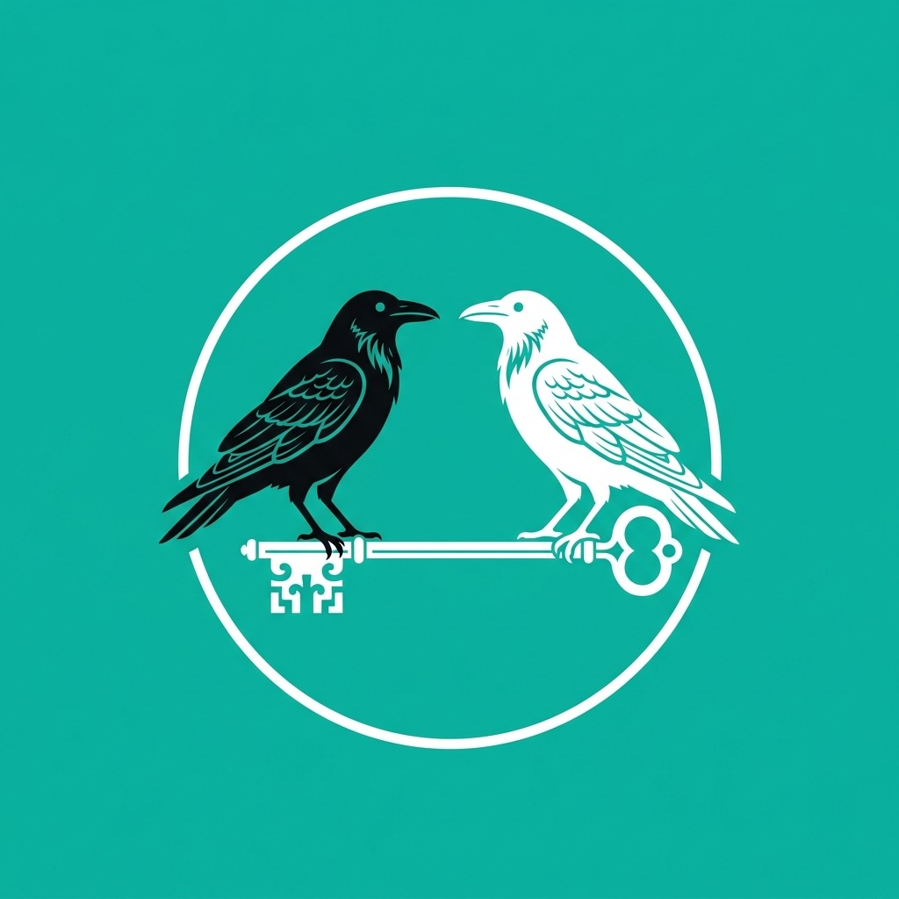
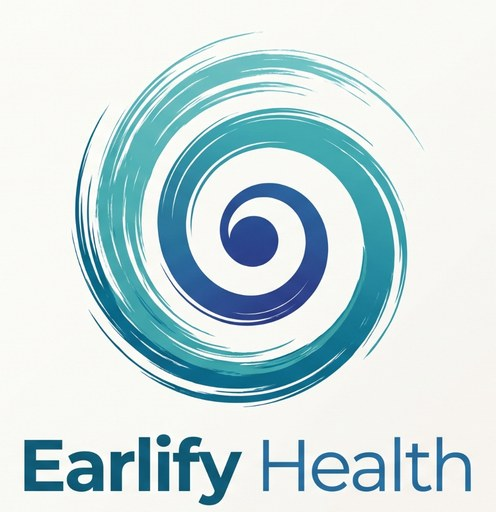

# Descubre con Lúa

Aplicación Android educativa, **sin conexión**, para las escuelas infantiles
de Galicia y sus familias. Cubre las dos
etapas de educación infantil: **primer ciclo (0-3 años)** y **segundo ciclo
(3-6 años)**. Todo el contenido existe en gallego y castellano.

Al abrirla hay una sola pregunta —**¿Dónde la vas a usar?**— y dos respuestas:
**En casa**, que abre el Portal Familias, y **En la escuela**, que abre el
Portal Docentes. Cada portal se abre por lo que toca hoy y tiene cuatro
pestañas, siempre en el mismo sitio: *Hoy · Calendario · Explorar · Guías* en
casa y *Hoy · Calendario · Recursos · Yo* en la escuela.

- **La lección de la semana** — los dos portales se abren por ella. El curso de
  cada grupo es una fila de lecciones de una semana que salen del plan
  curricular y de la unidad de cada mes: diez unidades por curso, de cuatro
  lecciones, sin repetir palabras entre cursos y con repaso espaciado desde
  semanas anteriores. Cada semana de las cinco edades trae tres capas ligadas
  al experimento STEAM del mes (**núcleo**, **Máis / Más** y **Apoio / Apoyo**).
  Las **48 unidades de gramática** forman una escalera por dominio con techo
  según la edad: 0-2 años trabaja 60 piezas básicas en cinco familias con el
  STEAM del mes (sin gramática explícita); 2-3 años hasta el punto 9 con
  fórmulas fijas; 3-4 años, los puntos A1; 4-5 y 5-6 años, hasta A2; y las
  unidades 21 a 48 (B1-C1) quedan como guía de consulta para la persona adulta.
  Arriba dice dónde se está en la ruta, el tema del mes y la lección; debajo,
  los cinco días de la semana, las palabras nuevas y de repaso, la frase de la
  unidad y lo que ya salió antes. La guía —qué hacer, cómo esperar y por qué—
  va plegada. La misma lección sale en los dos calendarios, en la nota que la
  escuela da a las familias y en el código para casa.
- **Hoy, en la escuela** — la lección de la semana y la sesión de 45 minutos;
  debajo, como material complementario, la asamblea diaria de cuatro fases, las
  palabras del banco, el plan del mes, el cuento, la dinámica y la ciencia.
- **Hoy, en casa** — arriba muestra en fila cada niño o niña registrada en ese
  móvil (puede haber varios de edades distintas) con su actividad del día; un
  toque cambia al niño o a la niña activa en Hoy, Calendario y Explorar. El
  alta se hace una sola vez (datos, mes y año de nacimiento sin día, una o dos
  rutinas del hogar —baño, comida, coche, vestirse, ir a dormir o parque— y,
  desde los 2 años, el juego inicial de Lúa para saber por dónde empezar). Cada
  semana, un ajuste automático adapta el cupo de palabras nuevas y la capa del
  niño o la niña sin porcentaje ni calificación clínica, explicando el motivo en
  una línea; debajo muestra sus palabras con lámina y audio (**Vuelven hoy**),
  el marcador de diez segundos al terminar el juego, **Lúa pregunta** los
  domingos, el contador de cuántas veces oyó cada palabra, sus rutinas de casa
  con el STEAM del mes, el **Reto de hermanos** si hay dos cursos distintos en
  casa y la tarjeta de Lúa para enseñar en la escuela infantil. Plegado en
  «Más para casa», el código de la escuela, el juego diario, **Ponte al día**,
  el reto del mes con su microcuento y el cuento.
- **Juega con Lúa · Modo Aula** — todas las asambleas, de cualquier grupo, mes y
  día; el grupo, el mes y el día van en una línea que se abre si hace falta.
- **Yo, en la escuela** — el nivel y la racha de la docente, *Antes de entrar
  en el aula* —la guía de dos minutos—, **El modelo** y **Formación en el
  aula**: las cuatro fases de la asamblea, con su lectura corta, y delante
  El modelo.
- **El modelo** — cómo habla la persona adulta, en Yo (aula) y en Guías
  (casa): el parentese, por qué un audio o una pantalla no sustituyen a la
  persona, el habla paralela, la espera en tres tiempos, la expansión, el
  recast, qué cabe esperar en cada edad y qué no mide la app. Cada técnica
  trae un ejemplo con su frase en inglés y su voz.
  En casa, delante, la guía de casa en diez ideas y la guía de cada edad, de
  0 meses a 6 años.
- **Escucha la diferencia** — desde 2-3 años, cada mes trae un par de palabras
  del curso que la voz inglesa de la app distingue (*fit* y *feet*, *bus* y
  *buzz*…), para el oído de la persona adulta, con cómo decirlas. Está en el
  calendario y en la tarjeta del mes del Modo Aula.
- **El Planificador** — en Recursos de la escuela: el área por su nombre
  oficial, el criterio de cada curso y, mes a mes, el centro de interés, la
  unidad del plan curricular y el núcleo. El criterio sale del texto curricular
  aportado al proyecto y está pendiente de contrastar con el Diario Oficial de
  Galicia; la app lo dice en la misma pantalla.
- **El microcuento del mes** — de 2-3 a 5-6, un cuento dialógico de tres o
  cuatro láminas por unidad: en el aula, debajo de «Comenzar la asamblea», con
  la tríada y el guion de recast; en casa, en Explorar → Cuentos, con una
  pregunta por lámina. Lúa solo habla en inglés; la historia la cuenta la
  persona adulta en gallego o en castellano.
- **La sesión de 45 minutos** — en el Modo Aula de los dos ciclos, para una
  sola adulta: acogida y pulso, cuento dialogado con el microcuento del mes,
  taller TPR con el material y las órdenes de la unidad, y despedida con la
  bolsa misteriosa. En 2.º ciclo es el período semanal de inglés; en 1.º, una
  sesión propuesta. La asamblea corta sigue como opción diaria.
- **Hoy hice** — al final de Hoy, una lista cerrada de lo que la persona
  adulta hizo ese día (por ejemplo, «esperé hasta cinco»). Es solo para ella:
  se guarda el día, sin hora, y lo que marcó; nada de ningún niño ni niña.
- **Asamblea matinal de segundo ciclo** — para 4.º, 5.º y 6.º de Infantil, con
  el inglés como tercera lengua. Cuatro fases —apertura, foco rítmico, reto TPR
  y calma—; cada una ocupa la pantalla entera, con su consigna en letra grande,
  su grabación y sus minutos. Es **la misma pantalla que la asamblea de primer
  ciclo**: el producto tiene un solo lenguaje visual. Se abre desde Hoy, desde
  «Comenzar la asamblea» en la pestaña 2.º ciclo del Modo Aula o desde el día
  del Calendario. Si la orden del día usa palabras que el curso enseñó antes,
  justo antes del reto TPR va **Antes de la orden**: esas palabras, una a una,
  con su voz y su gesto, para que quien llega nuevo al grupo pueda seguirla, y
  una nota para la docente. En primer ciclo sale en cinco órdenes de 2-3 años;
  en 0-2, nunca.
- **Guías para la familia** (Academy) — lecturas cortas para la persona adulta,
  en la pestaña Guías del Portal Familias. Incluye la
  **micro-rutina del mes** para segundo ciclo: tres minutos en un momento
  concreto del día, con ejemplos de cómo devolver la frase bien dicha sin pedir
  que el niño o la niña la repita.
- **STEAM · Ciencia con las manos** — cinco sesiones de ciencia con materiales
  reales, una por curso de 12 meses a 6 años: blando y duro, la rampa, el
  sonido, las sombras y un robot que programan los niños y las niñas. Cada una tiene su
  **versión para el aula**, que se abre desde el Portal Docentes con el grupo
  elegido en Hoy, y su **versión para casa**, que se abre desde Explorar con la
  edad elegida. Empiezan por su aviso de seguridad y traen las órdenes en inglés con
  su grabación. No evalúan ni registran nada: dicen qué observar. El día que le
  toca a cada curso, la sesión sale sola en Hoy, en el día del Modo Aula y en
  el Calendario Escola · Fogar, con la versión de casa del lado de las familias;
  los demás días, Hoy de la docente dice cuándo toca.
- **Calendario Escola · Fogar** — los seis años del trayecto, de 0-2 a 5-6:
  cinco cursos de diez meses, de septiembre a junio, uno por tarjeta. Se pasa
  deslizando de lado, y de junio de un curso se llega a septiembre del
  siguiente. Arriba se elige el curso —el del grupo en el aula, el de la
  niño o niña en casa— y el calendario salta al mismo mes de ese curso. La docente
  registra la asamblea, la familia registra el juego de tres minutos en casa, y
  el día que coinciden las dos cosas queda enlazado.
- **Estimulación del lenguaje y el pensamiento** — arriba de Hoy, en casa y en
  el Modo Aula. Cada mes y cada edad, de 2-3 a 5-6 años, trae el experimento
  STEAM del mes y cuatro partes: **Escucha** (un par de palabras inglesas que
  cambian en un solo sonido), **Palabras que crecen** (concepto, parte, acción y
  cualidad), **Háblale así** (tres frases que crecen para la persona adulta) y
  **Pensamos** (predice, prueba, compara y explica sobre el mismo experimento).
  En 0-2 años, un momento de «mira y nota» por proyecto. Cada frase inglesa
  para el niño o la niña suena en voz de niño y, con **Oír despacio**, más lenta.
- **Juegos de escucha** — en Explorar (casa): los pares, progresiones y
  cápsulas de escucha en gallego y castellano, con lámina y voz.
- **Tus premios** — Lúa y sus premios: nivel, XP, racha e insignias de la
  niño o niña registrada en casa, que gana la persona adulta en su nombre al
  marcar el juego del día y lo que entiende o dice; y los contadores de la
  persona adulta (asambleas, cápsulas) y las medallas del calendario.

**El inglés no es una lengua de esta app: es contenido que se escucha.** Ninguna
pantalla se lee en inglés. Lo que hay son las palabras, las órdenes de cuerpo
(TPR) y la frase de cada mes, cada una con su grabación: la persona adulta pulsa
y oye cómo se dice antes de decírselo al niño o a la niña. Una maestra de una escuela
infantil de Galicia no tiene por qué pronunciar «Crunch leaves» de oído.

En segundo ciclo el inglés entra como **tercera lengua dentro de la asamblea**,
siempre asociado al movimiento y sin pedir que nadie lo produzca: la orden se
dice y se hace, y el niño o la niña responde con el cuerpo. El gallego y el castellano
siguen siendo las lenguas del aula y de la casa.

**Cinco palabras nuevas al día.** De lunes a jueves entran cinco palabras o
frases inglesas nuevas (bloques A, B, C y D), y cada día se repasan las de los
días anteriores de esa semana; el viernes no entra ninguna y se juega un reto
con las veinte. Son 20 por semana, 80 por mes, 800 por curso y **4.000 en los
cinco cursos, de 0 a 6 años**, sin que ninguna sea nueva dos veces en todo el
trayecto: sustantivos, verbos, adjetivos, oraciones y preguntas, y estructuras
con conectores. Cada una trae lo que significa en gallego y en castellano y el
gesto que la acompaña. Cada grupo del aula tiene su curso. La docente las ve en
Hoy, en el día del Modo Aula y en el día del Calendario, junto a la asamblea de
ese día; la familia ve **las mismas** ese día, con una dinámica
pensada para casa.

**El cuento de la semana** lleva dentro esas veinte palabras, entre comillas y
resaltadas, con su gesto y su voz debajo de cada página; abierto desde Hoy, se
marcan las del día. Cada vez que se abre la app, el primer cuento empieza por
**Cómo funciona el cuento**: unas pocas frases que dicen qué es cada cosa, qué
se hace con ella y cómo leerlo con el niño o la niña. Después queda en una línea que
se abre al tocarla. Debajo de cada página va el reto en inglés; si da por
sabidas palabras de antes, lo dice en una línea que, al tocarla, las enseña con
su gesto y su voz.

El grupo **Inglés** de Recursos, en el Portal Docentes, trabaja esas mismas
palabras, una fila para cada parte: se consultan por curso,
mes, semana y día, con buscador; se repasan con repaso espaciado —las de hoy y
las que ya salieron en el curso, cada una cuando le toca—; se escuchan las
frases y órdenes de cada mes antes de leerlas; y se completan con 63
colocaciones (*wash your hands*, *put on your coat*…) y los 44 fonemas del
inglés, cada uno con su palabra de ejemplo.

**Finalidad exclusivamente educativa.** No es un producto sanitario: no evalúa,
no diagnostica y no trata nada. El niño o la niña no usa la pantalla; la app es para
la persona adulta que acompaña.

  
  &nbsp;&nbsp;&nbsp;
  

  
  &nbsp;&nbsp;&nbsp;
  

  <strong>Dr. Frank Alberto Betances Reinoso</strong> · <strong>Earlify
  Health S.L.</strong> · Incubadora de Alta Tecnoloxía <strong>startTIC</strong>
  · <strong>Consorcio da Zona Franca de Vigo</strong>

El proyecto **nace dentro del programa startTIC**, que es parte del **Consorcio
da Zona Franca de Vigo**, y está pensado para las **escuelas infantiles de
Galicia**. Las marcas de la cabecera y de los créditos están por procedencia
—de dónde sale esto—, no como respaldo pedido a un tercero.

**Licencia: gratis para las familias, con licencia para las instituciones.**
Para una familia o una persona a título individual, gratis y para siempre. Para
una escuela, un ayuntamiento, un gabinete o una empresa, hace falta una licencia
por escrito. El texto completo está en [LICENSE.md](LICENSE.md).

## Documentación

| | |
| --- | --- |
| [**Manual de uso**](docs/manual-casos-de-uso.html) | Para la docente, la familia y quien tenga que entender el proyecto sin abrirlo: qué es la app, cómo funciona el mes, y qué hay en cada una de sus partes —el inicio, los dos portales con sus pestañas, el Modo Aula de los dos ciclos, el calendario, las guías para la familia, STEAM, las lenguas y la voz, los premios y la privacidad—. También en [PDF](docs/Descubre-con-Lua-Manual-Casos-de-Uso.pdf) y [Word](docs/Descubre-con-Lua-Manual-Casos-de-Uso.docx) |
| [**Catálogo de material por edades**](docs/catalogo-por-idades.html) | Todo el contenido semanal de los cinco cursos (0-2 a 5-6 años) y la guía adulta 21-48, también en [PDF](docs/Descubre-con-Lua-Material-por-edades.pdf) |
| [**Base pedagógica de STEAM**](docs/BASE_PEDAGOGICA_STEAM.md) | Qué hay en las cinco sesiones STEAM y por qué, sus criterios de seguridad y sus fuentes |
| [**STATUS.md**](STATUS.md) | Estado de verificación técnica, gates de comprobación, tubería de compilación y estructura interna del repositorio |
| [**LICENSE.md**](LICENSE.md) | Quién puede usar esto y con qué condiciones |

## Qué hay dentro

| | |
| --- | --- |
| Contenido · primer ciclo | 20 asambleas de 4 fases, una por mes del curso en cada tramo (0-2 y 2-3 años) |
| Canciones con pulso | 10, una por mes del curso, en Recursos del Portal Docentes, con el pulso dibujado |
| Calendario e inglés | 50 meses de calendario (5 cursos × 10, de 0-2 a 5-6 años) · 200 semanas con tres capas STEAM (**núcleo**, **Máis / Más**, **Apoio / Apoyo**) y 6 rutinas del hogar por capa · 4.000 palabras inglesas, 800 por curso · 63 colocaciones · 44 fonemas |
| 0-2 años · núcleo de casa | 60 piezas en cinco familias (sustantivos, adjetivos, onomatopeyas unidas a su objeto, rutinas y sucesos, series básicas) ligadas al STEAM del mes |
| Niveles, entrada y hermanos | Juego inicial de Lúa para casa (72 ítems STEAM en 6 peldaños por curso desde los 2 años) · ajuste dinámico semanal · 160 retos semanales de hermanos entre cursos vecinos |
| Contenido · segundo ciclo | 3 asambleas matinales, una por nivel (4.º, 5.º y 6.º de Infantil), de 4 fases cada una |
| Cuentos | 100 cuentos dialogados de tres o cuatro láminas, cada uno atado a su unidad del plan curricular, y 40 microcuentos, uno por mes desde 2-3 años, más los 200 cuentos semanales y 103 adicionales |
| Ponte al día | Palabras de cursos o meses anteriores que dan por sabidas las asambleas y los retos de los cuentos, revisadas a mano, cada una con su gesto y su voz |
| Cápsulas | 12: 6 de Academy para las familias y 6 de formación docente |
| STEAM | 5 sesiones de ciencia, una por curso de 12 meses a 6 años, y 50 experimentos del mes, uno por mes y curso, cada uno en versión de aula y de casa |
| Voz | 41.549 locuciones catalogadas (18.693 en inglés, 11.429 en gallego y 11.427 en castellano; 735 en voz de niño y 6.761 lentas), empaquetadas sin conexión en el APK |
| Estimulación del lenguaje y el pensamiento | 40 piezas, una por mes y edad de 2-3 a 5-6 años, cada una con su par mínimo, su progresión, el modelo del adulto y cuatro momentos de pensamiento sobre el experimento STEAM del mes; 10 proyectos de 0-2 con «mira y nota» |
| Casa | En cada uno de los 50 meses, cuatro retos semanales, la lectura del microcuento, rutinas del hogar con STEAM, un juego, qué mirar y la palabra del mes anterior; una guía de casa y una guía por edad |
| Premios | Los del niño o de la niña (nivel, racha e insignias de Lúa) y los de la persona adulta (contadores y medallas de calendario) |

La aplicación **no declara ningún permiso de red**. Todo el detalle técnico
de comprobación, compilación y publicación vive en [STATUS.md](STATUS.md).

## El pulso se ve, no se oye

El metrónomo de la canción a pulso es **visual**. No es una decisión estética:
parte de los niños y las niñas llevan audiófono o implante, y un metrónomo sonoro
compite justo con la voz que tienen que seguir.

Los tiempos del compás salen de las marcas `*` de la letra, no de una
configuración aparte, así que el pulso no puede discrepar de lo que la docente
lee.

## Dónde aparece Lúa

La gata es la marca, no un reclamo para el niño o la niña: **aparece para la docente
y para la familia, nunca para captar la atención infantil**. Se pinta siempre
desde la misma rejilla de caracteres que rinde el icono del lanzador y el
splash (`assets/brand/lua_*.txt`), así que no puede separarse del icono.

Dentro de una actividad sale en dos sitios:

| Dónde | Qué hace |
| --- | --- |
| El cierre de cada cápsula de Academy | Una frase —`luaDice` en el JSON— que convierte la idea de la cápsula en **un** gesto para hoy. Va la última, detrás de la reflexión: la cápsula se cuenta como leída al responderla, así que el premio cae primero y la gata cierra |
| La nota para las casas | Encabeza la nota que cruza del aula al hogar, que es la única pantalla que habla de ella por su nombre |

Fuera de una actividad sale en la bienvenida, en los premios, en el calendario
y en los créditos.

Las cápsulas de formación del aula **todavía no traen cierre**: `luaDice` es
opcional y, sin él, el lector no pinta la página.

## Voz

El audio se genera con voces neuronales en tiempo de compilación y viaja
grabado dentro del paquete. Los modelos **nunca** corren en el aparato.

Casi todas las tarjetas con texto seguido llevan botón de altavoz: la lectura
del cuento, las preguntas, la exploración, las matemáticas, el puente con la
casa, y en Academy las cuatro partes de cada cápsula, sus afirmaciones y el
cierre de Lúa. Si un texto no tiene grabación, el botón **no se pinta** —ni
apagado ni con aviso—: un altavoz que no suena promete algo que no cumple.

- gallego → **Celtia**, do Proxecto Nós
- castellano → **Sharvard**
- inglés → **LJSpeech**

**El inglés es un caso aparte.** No hay pantallas en inglés: lo que se graba son
las 4.000 palabras de los cinco cursos, las órdenes TPR, la frase de cada mes
del calendario y de cada uno de los 50 meses del trayecto, las colocaciones,
los retos de hermanos, las piezas de la prueba inicial de Lúa, las palabras de
ejemplo de los fonemas y, aparte, **las 4.000 palabras de uso habitual del inglés
con su frase completa**. Las palabras y frases dirigidas al niño o a la niña en
casa, en estimulación y en 0-2 años van en **voz de niño** y en una versión
**lenta** («Oír amodo / Oír despacio»). La persona adulta pulsa la pastilla y
oye cómo se dice antes de decírselo al niño o a la niña. Una pastilla sin
grabación se pinta igual, con la palabra legible y sin altavoz.

El identificador de cada grabación corresponde al propio texto, así que texto y
locución permanecen siempre emparejados sin descarga externa.

## Privacidad

Ningún dato sale del aparato: cero analítica, cero SDK de terceros y ningún
permiso de red. En casa, el nombre, el mes y año de nacimiento (sin día), el
curso de cada niño y lo que la familia marca de sus palabras se guardan solo en
el móvil.

**Lo único que la app guarda**, en el almacenamiento privado del aparato y en
tres ficheros:

- los contadores de los premios **de la persona adulta** —asambleas dirigidas,
  cápsulas leídas, racha, la fecha del último día *sin hora* e insignias—;
- si usa el repaso de inglés, **una ficha de repaso por palabra**: la palabra,
  los números del repaso espaciado y dos fechas *sin hora*;
- **solo en casa**, de cada niño el nombre o apodo que escribe la familia, el
  mes y año de nacimiento (sin día), la edad, el curso y el año de revisión de
  septiembre, las rutinas del hogar elegidas, su peldaño, cupo y estado del
  juego inicial de Lúa más la tasa, capa por semana del curso y retos semanales
  de hermanos por pareja de cursos y semana del curso (sin fecha ni hora), cuántas
  semanas lleva con marcas (sin fecha ni hora), cuántas veces ha oído cada
  palabra (sin hora), lo que la persona adulta marca de sus
  palabras por semana (sin fecha ni hora), su ficha de repaso espaciado por
  palabra (fechas en día, sin hora) y sus premios con Lúa. Se borra desde la
  app o al desinstalarla. En el aula no se registra a ningún niño.

**URLs legales** (publicadas junto con la aplicación):

| | |
| --- | --- |
| Política de privacidad | `https://frankbetances.github.io/Descubre-con-lua/privacy.html` |
| Página del proyecto | `https://frankbetances.github.io/Descubre-con-lua/` |

Contacto: frank.alberto.betances.reinoso@gmail.com

## El manual

El manual completo de uso está disponible en [HTML](docs/manual-casos-de-uso.html),
[PDF](docs/Descubre-con-Lua-Manual-Casos-de-Uso.pdf) y
[Word](docs/Descubre-con-Lua-Manual-Casos-de-Uso.docx), ilustrado con las
pantallas reales de la aplicación en gallego y en castellano (no son fotografías
de un teléfono físico: muestran el diseño y los textos de la interfaz dentro
del documento).

## Licencia

**Gratis para las familias. Con licencia para las instituciones.**

| Quién | Qué puede hacer |
| --- | --- |
| Una familia, una persona a título individual | Usar la app, leer y compilar el código, modificarlo para su casa. **Gratis, para siempre, sin pedir permiso** |
| Una escuela, un ayuntamiento, un hospital, una asociación, una universidad | **Licencia previa por escrito**, aunque el uso sea gratuito y la entidad no tenga ánimo de lucro |
| Cualquiera que cobre por usarla o por servicios prestados con ella | **Licencia previa por escrito** |

Nadie —ni siquiera en uso personal— puede redistribuirla, publicarla en una
tienda, quitarle los créditos ni presentarla como propia.

Las condiciones de una licencia institucional se acuerdan caso por caso y
**pueden ser gratuitas** (convenios con administraciones, pilotos). Se piden en
frank.alberto.betances.reinoso@gmail.com.

Los componentes de terceros conservan su licencia: las tipografías Nunito y
Fredoka (SIL OFL 1.1), las imágenes de Fluent Emoji (MIT), Google ARCore SDK,
Google Filament y Google MediaPipe Tasks Vision (Apache 2.0), Flutter y sus
paquetes, y los modelos de voz Celtia, Sharvard y LJSpeech, que **solo corren en
compilación y nunca en el aparato**. Los logotipos institucionales son marcas de
sus titulares y no se licencian aquí.

El texto que manda es [LICENSE.md](LICENSE.md).
