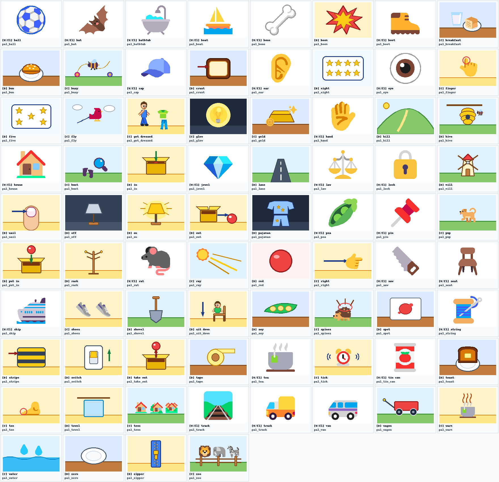

# Control de xogos de escoita e expansión semántica (P7.4 · O-20261119-8 e O-20261118-3)

Control das **40 pezas mensuais** de `assets/content/escoita/plan_mensual.json` (cursos `curso_2_3`, `curso_3_4`, `curso_4_5` e `curso_5_6`; meses 1 a 10, onde 1 = setembro).

- **Parellas de Valeria:** 9 (`peach-beach`, `sheep-ship`, `seat-sea`, `key-tea`, `thin-fin`, `sip-ship`, `rake-wake`, `snail-nail`, `lock-rock`) · **Novas:** 31 · **Total:** 40 (sen repeticións).
- **Progresións de Valeria:** 9 (`en-seq-bread`, `en-seq-bird`, `en-seq-train`, `en-seq-car`, `en-seq-rain`, `en-seq-cow`, `en-seq-dog`, `en-seq-cat`, `en-seq-balloon`) · **Novas:** 31 · **Total:** 40 (sen repeticións).
- **Gate fonético:** `python3 tools/check_pares_en.py` (CMUdict en `tools/banco/cmudict_escoita.txt`, 76 palabras, exactamente 1 fonema distinto e sen contrastes prohibidos).
- **Láminas novas (P7.3):** 76 (47 do banco de Valeria en gl/es + 29 adicionais de `plan_mensual.json`), revisadas en `docs/capturas/hoja_contactos_escoita.png`.

| Curso | Mes | STEAM | Par | Fonema | Progresión (4 fases) | Láminas (par + progresión) | Fuente | Por que encaixa na idade |
| --- | --- | --- | --- | --- | --- | --- | --- | --- |
| `curso_2_3` | 1 | ¿Flota o se hunde? | boat / boot | `/oʊ/ → /u/` | Juguetes en el agua · El pato (duck, beak, float, yellow) | `pal_boat`, `pal_boot`, `pal_duck`, `pal_beak`, `pal_float`, `pal_yellow` | `nueva` | 2-3 anos: contraste vocálico claro entre ditongo aberto e vogal pechada, con obxectos cotiáns do xogo na auga/merenda. |
| `curso_2_3` | 2 | El viento empuja el barco | toe / toy | `/oʊ/ → /ɔɪ/` | El cuerpo · La mano (hand, finger, wave, clean) | `pal_toe`, `pal_toy`, `pal_hand`, `pal_finger`, `pal_wave`, `pal_clean` | `nueva` | 2-3 anos: contraste vocálico de peche redondeado fronte a aberto con palabras curtas do corpo e do xogo. |
| `curso_2_3` | 3 | Grande aquí, pequeño allí | big / pig | `/b/ → /p/` | Otoño en Castrelos · El árbol (tree, leaf, shake, tall) | `pal_big`, `pal_pig`, `pal_tree`, `pal_leaf`, `pal_shake`, `pal_tall` | `nueva` | 2-3 anos: contraste temperán de oclusiva bilabial sonora/xorda (/b/–/p/) con vocabulario básico do curso. |
| `curso_2_3` | 4 | Pum grande, pum pequeño | bell / ball | `/ɛ/ → /ɔ/` | Sonidos de invierno · La campana (bell, handle, ring, loud) | `pal_bell`, `pal_ball`, `pal_bell`, `pal_handle`, `pal_ring`, `pal_loud` | `nueva` | 2-3 anos: contraste de vogal anterior fronte a posterior arredondada, con obxectos sonoros e de xogo temperán. |
| `curso_2_3` | 5 | Pan duro, pan blando | coat / goat | `/k/ → /g/` | Comida · El desayuno (bread, crust, bite, warm) | `pal_coat`, `pal_goat`, `pal_bread`, `pal_crust`, `pal_bite`, `pal_warm` | `valeria:en-seq-bread` | 2-3 anos: contraste de oclusiva velar xorda/sonora (/k/–/g/) con palabras familiares de roupa e animais. |
| `curso_2_3` | 6 | La estrella de la manzana | bee / pea | `/b/ → /p/` | Animales · El pájaro (bird, wing, fly, high) | `pal_bee`, `pal_pea`, `pal_bird`, `pal_wing`, `pal_fly`, `pal_high` | `valeria:en-seq-bird` | 2-3 anos: contraste temperán de oclusiva bilabial sonora/xorda (/b/–/p/) con vocabulario básico do curso. |
| `curso_2_3` | 7 | Primero mojo, después jabón | soap / soup | `/oʊ/ → /u/` | La merienda · El tomate (tomato, seed, wash, red) | `pal_soap`, `pal_soup`, `pal_tomato`, `pal_seed`, `pal_wash`, `pal_red` | `nueva` | 2-3 anos: contraste vocálico claro entre ditongo aberto e vogal pechada, con obxectos cotiáns do xogo na auga/merenda. |
| `curso_2_3` | 8 | La toalla mojada pesa | bud / bed | `/ʌ/ → /ɛ/` | Primavera · La flor (flower, petal, grow, bright) | `pal_bud`, `pal_bed`, `pal_flower`, `pal_petal`, `pal_grow`, `pal_bright` | `nueva` | 2-3 anos: contraste vocálico central/anterior curto en palabras CVC sinxelas de primavera e descanso. |
| `curso_2_3` | 9 | Pasos que corren, pasos que duermen | bath / path | `/b/ → /p/` | Higiene · La bañera (bathtub, water, splash, warm) | `pal_bath`, `pal_path`, `pal_bathtub`, `pal_water`, `charco`, `pal_warm` | `nueva` | 2-3 anos: contraste temperán de oclusiva bilabial sonora/xorda (/b/–/p/) con vocabulario básico do curso. |
| `curso_2_3` | 10 | La caja de las estrellas | peach / beach | `/p/ → /b/` | Las olas de Samil · El pez (fish, fin, swim, blue) | `pal_peach`, `pal_beach`, `pal_fish`, `pal_fin`, `pal_swim`, `pal_blue` | `valeria:peach-beach` | 2-3 anos: parella de Valeria con oclusiva bilabial (/p/–/b/), axeitada para a escoita inicial de 2-3 anos. |
| `curso_3_4` | 1 | ¿Qué torre aguanta? | down / town | `/d/ → /t/` | Construcciones · La torre (tower, block, build, tall) | `pal_down`, `pal_town`, `pal_tower`, `pal_block`, `pal_build`, `pal_tall` | `nueva` | 3-4 anos: contraste de oclusiva alveolar sonora/xorda (/d/–/t/) unido ás construcións con bloques. |
| `curso_3_4` | 2 | Rojo, azul, rojo… | pin / bin | `/p/ → /b/` | Otoño · La bellota (acorn, cap, pick, brown) | `pal_pin`, `pal_bin`, `pal_acorn`, `pal_cap`, `pal_pick`, `pal_brown` | `nueva` | 3-4 anos: contraste de oclusiva bilabial (/p/–/b/) en palabras CVC curtas e doadas de debuxar. |
| `curso_3_4` | 3 | El tren baja la cuesta | pop / pup | `/ɑ/ → /ʌ/` | Transportes · El tren (train, track, go, long) | `pal_pop`, `pal_pup`, `pal_pal_train`, `pal_track`, `pal_go`, `pal_long` | `valeria:en-seq-train` | 3-4 anos: contraste de vogal aberta/media en palabras CVC ligadas ao magosto e aos animais. |
| `curso_3_4` | 4 | El teléfono de vasos | cap / gap | `/k/ → /g/` | Transportes · El coche (car, wheel, drive, fast) | `pal_cap`, `pal_gap`, `pal_car`, `pal_wheel`, `pal_drive`, `pal_fast` | `valeria:en-seq-car` | 3-4 anos: contraste de oclusiva velar (/k/–/g/) con léxico do inverno e da temperatura. |
| `curso_3_4` | 5 | La sombra de la torre | pat / bat | `/p/ → /b/` | Naturaleza · La lluvia (rain, drop, fall, wet) | `pal_pat`, `pal_bat`, `pal_rain`, `pal_drop`, `pal_fall`, `pal_wet` | `valeria:en-seq-rain` | 3-4 anos: contraste de oclusiva bilabial (/p/–/b/) en palabras CVC curtas e doadas de debuxar. |
| `curso_3_4` | 6 | El hielo en el zumo | cold / gold | `/k/ → /g/` | Hielo y líquido · El zumo (juice, ice, melt, cold) | `pal_cold`, `pal_gold`, `pal_juice`, `pal_ice`, `pal_melt`, `pal_cold` | `nueva` | 3-4 anos: contraste de oclusiva velar (/k/–/g/) con léxico do inverno e da temperatura. |
| `curso_3_4` | 7 | Un plato para cada uno | dig / big | `/d/ → /b/` | Semillas · La semilla (seed, root, sprout, tiny) | `pal_dig`, `pal_big`, `pal_seed`, `pal_root`, `pal_sprout`, `pal_tiny` | `nueva` | 3-4 anos: contraste entre dúas oclusivas sonoras de distinto punto (/d/–/b/) ligado a «Dig» do mes. |
| `curso_3_4` | 8 | Verter despacio | sheep / ship | `/i/ → /ɪ/` | Animales · La vaca (cow, tail, eat, big) | `pal_pal_sheep`, `pal_ship`, `pal_pal_cow`, `pal_tail`, `pal_eat`, `pal_big` | `valeria:sheep-ship+en-seq-cow` | 3-4 anos: parella de Valeria con contraste de vogal longa/curta (/i/–/ɪ/), unida a «Sheep» do mes. |
| `curso_3_4` | 9 | La música de los vasos | pot / dot | `/p/ → /d/` | Lectura · El cuento (book, page, read, open) | `pal_pot`, `pal_dot`, `pal_book`, `pal_page`, `pal_read`, `pal_open` | `nueva` | 3-4 anos: contraste entre oclusiva bilabial e alveolar (/p/–/d/) con obxectos concretos do xogo musical. |
| `curso_3_4` | 10 | La cara en la cuchara | seat / sea | `/-t/ → ∅` | Espejo · La cuchara (spoon, handle, stir, shiny) | `pal_seat`, `pal_sea`, `pal_pal_spoon`, `pal_handle`, `pal_stir`, `pal_shiny` | `valeria:seat-sea` | 3-4 anos: parella de Valeria de oclusiva final xorda (/t/) fronte a vogal aberta, ligada a «Sea» do mes. |
| `curso_4_5` | 1 | ¿Qué venda absorbe? | cape / tape | `/k/ → /t/` | Colegio · La mochila (backpack, zipper, carry, heavy) | `pal_cape`, `pal_tape`, `pal_backpack`, `pal_zipper`, `pal_carry`, `pal_heavy` | `nueva` | 4-5 anos: contraste velar/alveolar (/k/–/t/) propio da etapa 4-5, con palabras concretas do mes. |
| `curso_4_5` | 2 | Escuchar el corazón | fox / box | `/f/ → /b/` | Animales · El perro (dog, tail, run, soft) | `pal_fox`, `pal_box`, `pal_dog`, `pal_tail`, `pal_run`, `pal_soft` | `valeria:en-seq-dog` | 4-5 anos: contraste fricativa labiodental fronte a oclusiva bilabial (/f/–/b/) unido aos animais do bosque. |
| `curso_4_5` | 3 | Dos patas, cuatro patas | hill / mill | `/h/ → /m/` | Otoño · El erizo (hedgehog, spines, roll, spiky) | `pal_hill`, `pal_mill`, `pal_ourizo`, `pal_spines`, `pal_roll`, `pal_spiky` | `nueva` | 4-5 anos: contraste fricativa glotal fronte a nasal bilabial (/h/–/m/) con léxico da paisaxe e dos contos. |
| `curso_4_5` | 4 | Con la lupa, más grande | key / tea | `/k/ → /t/` | Animales · El gato (cat, whiskers, climb, soft) | `pal_key`, `pal_tea`, `pal_cat`, `pal_whiskers`, `pal_climb`, `pal_soft` | `valeria:key-tea+en-seq-cat` | 4-5 anos: contraste velar/alveolar (/k/–/t/) propio da etapa 4-5, con palabras concretas do mes. |
| `curso_4_5` | 5 | La camilla | van / fan | `/v/ → /f/` | La tormenta · El paraguas (umbrella, handle, open, dry) | `pal_van`, `pal_fan`, `pal_pal_umbrella`, `pal_handle`, `pal_open`, `pal_dry` | `nueva` | 4-5 anos: parella de fricativas labiodentais sonora/xorda (/v/–/f/) propia de 4-5 anos. |
| `curso_4_5` | 6 | Hacemos barro | shoe / zoo | `/ʃ/ → /z/` | Animales del monte · El zorro (fox, paw, sneak, quiet) | `pal_shoe`, `pal_zoo`, `pal_fox`, `pal_paw`, `pal_sneak`, `pal_quiet` | `nueva` | 4-5 anos: contraste de fricativas sibilantes (/ʃ/–/z/) con palabras de vestimenta e animais. |
| `curso_4_5` | 7 | El molinillo de viento | hive / five | `/h/ → /f/` | Polinización · La abeja (bee, stripe, buzz, busy) | `pal_hive`, `pal_five`, `pal_bee`, `pal_stripe`, `pal_buzz`, `pal_busy` | `nueva` | 4-5 anos: contraste de dúas fricativas xordas (/h/–/f/) ligado ás abellas e aos números. |
| `curso_4_5` | 8 | La orquesta de la tormenta | zoom / boom | `/z/ → /b/` | El bosque · El lobo (wolf, ear, howl, hungry) | `pal_zoom`, `pal_boom`, `pal_wolf`, `pal_ear`, `pal_howl`, `pal_hungry` | `nueva` | 4-5 anos: contraste fricativa sonora fronte a oclusiva (/z/–/b/) con onomatopeas sonoras da tormenta. |
| `curso_4_5` | 9 | La sombra y el sol | thin / fin | `/θ/ → /f/` | Luz y sombra · El sol (sun, ray, shine, bright) | `pal_thin`, `pal_fin`, `pal_sun`, `pal_ray`, `pal_shine`, `pal_bright` | `valeria:thin-fin` | 4-5 anos: parella de Valeria con fricativas interdental/labiodental (/θ/–/f/), con aviso dialectal para familias. |
| `curso_4_5` | 10 | ¿Qué ropa pide el tiempo? | ship / sip | `/ʃ/ → /s/` | Juego · El globo (balloon, string, pop, round) | `pal_ship`, `pal_sip`, `pal_balloon`, `pal_string`, `pal_pop`, `pal_round` | `valeria:sip-ship+en-seq-balloon` | 4-5 anos: parella de Valeria de sibilantes (/ʃ/–/s/) propia de 4-5 anos e unida ao mar. |
| `curso_5_6` | 1 | Colores que nacen | spot / pot | `/sp-/ → /p-/` | Colores que nacen · La pintura (paint, brush, mix, green) | `pal_spot`, `pal_pot`, `pal_pal_paint`, `pal_brush`, `pal_mix`, `pal_green` | `nueva` | 5-6 anos: grupo consonántico inicial /sp-/ fronte a /p-/ en palabras concretas das actividades do mes. |
| `curso_5_6` | 2 | El mundo de colores | rake / wake | `/r/ → /w/` | Clasificación · La hoja (leaf, stem, sort, smooth) | `pal_rake`, `pal_wake`, `pal_leaf`, `pal_stem`, `pal_sort`, `pal_smooth` | `valeria:rake-wake` | 5-6 anos: parella de Valeria con /r/ inicial fronte a /w/, propia do tramo 5-6 anos. |
| `curso_5_6` | 3 | La mariposa igual | light / right | `/l/ → /r/` | Simetría · La mariposa (butterfly, spot, land, bright) | `pal_light`, `pal_right`, `pal_butterfly`, `pal_spot`, `pal_land_action`, `pal_bright` | `nueva` | 5-6 anos: contraste inicial /l/–/r/ propio da etapa 5-6, ligado á simetría esquerda/dereita. |
| `curso_5_6` | 4 | El círculo que gira | spin / pin | `/sp-/ → /p-/` | Circuito con luz · La lámpara (lamp, switch, glow, yellow) | `pal_spin`, `pal_pin`, `pal_lamp`, `pal_switch`, `pal_glow`, `pal_yellow` | `nueva` | 5-6 anos: grupo consonántico inicial /sp-/ fronte a /p-/ en palabras concretas das actividades do mes. |
| `curso_5_6` | 5 | ¿Cuántos sonidos tiene el papel? | clap / lap | `/kl-/ → /l-/` | Sonidos del papel · El papel (paper, corner, fold, thin) | `pal_clap`, `pal_lap`, `pal_pal_paper`, `pal_corner`, `pal_fold`, `pal_thin` | `nueva` | 5-6 anos: grupo inicial /kl-/ fronte a /l-/ unido aos patróns sonoros e palmadas. |
| `curso_5_6` | 6 | Aviones de papel | plane / lane | `/pl-/ → /l-/` | Aviones de papel · El avión (plane, nose, glide, white) | `pal_pal_plane`, `pal_lane`, `pal_pal_plane`, `pal_nose`, `pal_glide`, `pal_white` | `nueva` | 5-6 anos: grupo inicial /pl-/ fronte a /l-/ ligado directamente a «Plane» do STEAM. |
| `curso_5_6` | 7 | El mapa del tesoro | snail / nail | `/sn-/ → /n-/` | Orientación · El mapa (map, path, search, secret) | `pal_snail`, `pal_nail`, `pal_map`, `pal_path`, `pal_search`, `pal_secret` | `valeria:snail-nail` | 5-6 anos: parella de Valeria co grupo inicial /sn-/ fronte a /n-/, propia de 5-6 anos. |
| `curso_5_6` | 8 | La maleta que pesa | rock / lock | `/r/ → /l/` | Viaje y peso · La maleta (suitcase, handle, pack, full) | `pal_rock`, `pal_lock`, `pal_pal_suitcase`, `pal_handle`, `pal_pack`, `pal_full` | `valeria:lock-rock` | 5-6 anos: parella de Valeria co contraste inicial /r/–/l/, unida á maleta e ás rochas do mes. |
| `curso_5_6` | 9 | Mensajes de luz | stick / tick | `/st-/ → /t-/` | Patrones rítmicos · El tambor (drum, stick, beat, steady) | `pal_stick`, `pal_tick`, `pal_drum`, `pal_stick`, `pal_beat`, `pal_steady` | `nueva` | 5-6 anos: grupo inicial /st-/ fronte a /t-/ unido a «rhythm stick» do vocabulario do mes. |
| `curso_5_6` | 10 | La flauta del tren | track / rack | `/tr-/ → /r-/` | En la playa · La concha (shell, spiral, collect, white) | `pal_track`, `pal_rack`, `pal_pal_shell`, `pal_spiral`, `pal_collect`, `pal_white` | `nueva` | 5-6 anos: grupo inicial /tr-/ fronte a /r-/ ligado á vía do tren do STEAM do mes. |
